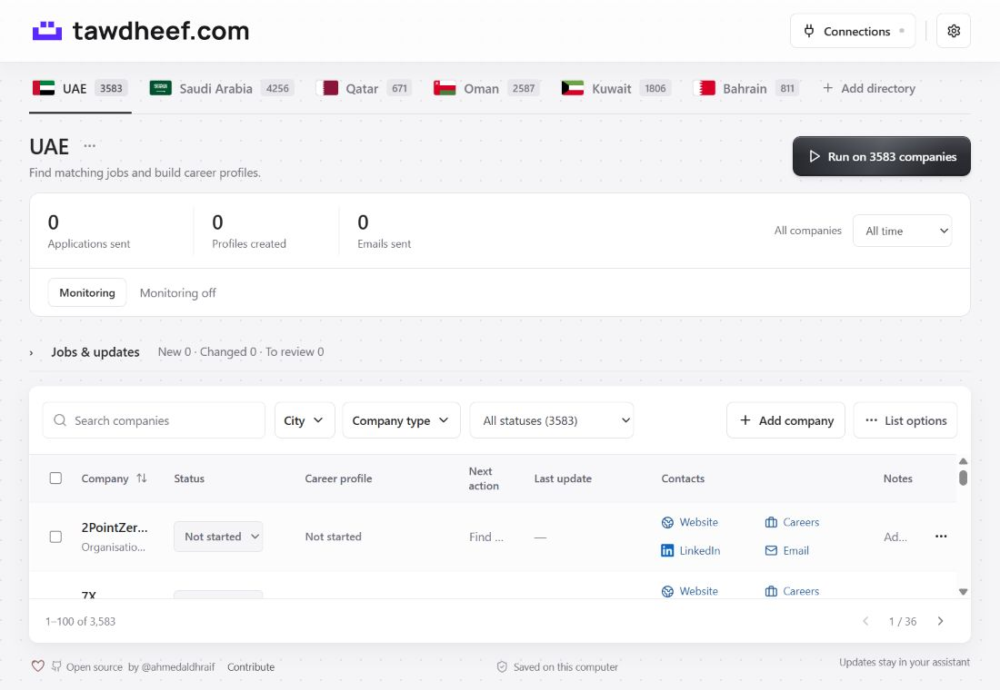

# توظيف - أتمتة التقديم للوظائف وتتبع الطلبات

[www.tawdheef.com](https://www.tawdheef.com/ar/) · [English](README.md)

<picture>
  <source media="(prefers-reduced-motion: reduce) and (prefers-color-scheme: dark)" srcset="public/brand/github-hero/wordmark-dark.png" />
  <source media="(prefers-reduced-motion: reduce)" srcset="public/brand/github-hero/wordmark-light.png" />
  <source media="(prefers-color-scheme: dark)" srcset="public/brand/github-hero/wordmark-dark.gif" />
  
</picture>

  

[ابدأ هنا](docs/i18n/ar/guides/use-the-skill.md) · [المهارات](https://www.tawdheef.com/ar/skills/) · [حزم الشركات](directories/README.md) · [الأدلة](https://www.tawdheef.com/ar/guides/) · [مصادر الأدلة](docs/i18n/ar/guides/README.md) · [ساهم](CONTRIBUTING.md) · [English](README.md)

**اعثر على وظائف تناسبك. أنشئ ملفاتك المهنية.**

توظيف (Tawdheef) مشروع مجاني ومفتوح المصدر للباحثين عن عمل في أي دولة. التطبيق وحزم الشركات والمهارة والأدلة أجزاء من مشروع واحد، والمساهمة متاحة للجميع.

تطبيق مجاني ومفتوح المصدر لك ولمساعدك Codex أو Claude Code. استكشف الشركات
والوظائف، وافهم سبب ملاءمة الفرصة لسيرتك، وتابع النتائج على جهازك. أنت تختار
الشركات والإجراءات قبل بدء Run. إنشاء حساب أو ملف مهني نتيجة مفيدة، ولا يعني
أن طلب توظيف أُرسل.

<picture>
  <source media="(max-width: 600px)" srcset="public/site-assets/walkthrough/native-mobile-light.jpg" />
  
</picture>

معاينة الواجهة ببيانات توضيحية. سجلات الشركات ليست وظائف شاغرة مؤكدة.

**الاتصالات في مساعدك الفعلي.** يملك Codex أو Claude أدوات السيرة الذاتية
والبريد والتقويم والمتصفح واستخدام الكمبيوتر ومدير كلمات المرور. يحتفظ توظيف
بالتوجيه والسجلات والأدلة محليًا، ويعمل بالوضع Native افتراضيًا. لا يشغّل
نموذجًا آخر أو جلسة دخول أخرى لمزوّد الخدمة.

[English](README.md) · [الإعداد](docs/FIRST-RUN.md) ·
[البحث عن الوظائف](docs/JOB-DISCOVERY.md) · [المساهمة](CONTRIBUTING.md)

## اختر نقطة البداية

- **استكشف الشركات:** استخدم [البحث العام](docs/i18n/ar/examples/README.md)
  و[حزم الشركات](directories/README.md) دون تثبيت التطبيق أو ربط سيرة ذاتية.
- **راجع الوظائف مع مساعدك:** افتح Jobs & updates وانسخ طلب المراجعة إلى
  محادثتك الحالية. يقرأ المساعد المصادر وسيرتك الحقيقية، ويعيد مراجعة ما
  تغيّر. المصدر المحجوب لا يعني عدم وجود وظائف.
- **اختر الإجراءات:** حدّد الشركات وخيارات Run. التطبيقات والملفات المهنية
  وإرسال السيرة للفرص المستقبلية خيارات مستقلة. تُسجّل النتيجة بعد وجود دليل.
- **ساعد المجتمع:** أرفق مصدرًا عامًا وتاريخ التحقق عند إضافة شركة أو دليل
  لأي دولة. يمكنك أيضًا تحسين الترجمة والمهارات والكود.

يمكنك إنشاء سيرة مجانية على [Tabbio](https://app.tabbio.com/) أو استخدام سيرتك
عبر اتصال يدعمه مساعدك. البحث العام متاح دون سيرة؛ المطابقة الشخصية تحتاج
قراءة حديثة للسيرة وتفضيلاتك. يحتفظ التطبيق بمراجع الإصدار والأدلة، لا بنسخة
كاملة من السيرة لهذا المسار. عنوان التواصل الاختياري لا يغيّر حساب الإرسال.

Preferences للتفضيلات الشخصية، وMonitoring للمصادر والجداول والتقارير.
المساعد الفعلي يملك الجدول المحلي؛ نسخ الطلب وحده لا ينشئ مهمة. أي تسجيل دخول
أو موافقة أو تحقق يحتاج الشخص يظهر كخطوة واضحة في Needs you.

نسخة المصدر تستخدم Node.js 26 وVite 8.3.8، مع توافق مختبر مع Node 24. الحزم
المبنية تتضمن Node والواجهة. تشغيل التطبيق محليًا لا يحتاج حساب مطوّر؛ توقيع
الإصدارات العامة خطوة منفصلة. قد تكون للمساعد والخدمات المتصلة تكاليف وحدود.

أنشأه [أحمد الضريف](https://www.linkedin.com/in/ahmedaldhraif).
[MIT](LICENSE) · [الخصوصية](docs/policies/PRIVACY.md) · [قواعد المجتمع](CODE_OF_CONDUCT.md)

## البدء بالمصدر الحالي

[نزّل المصدر الحالي](https://github.com/ahmedaldhraif/tawdheef-auto-apply-jobs/archive/refs/heads/main.zip)، وفك ضغطه، ثم نفّذ `npm start` باستخدام Node.js 26 LTS. افتح الاتصالات ← المساعد وانسخ طلب الإعداد إلى تطبيق مساعدك. تنزيل v0.1.2 السابق يستخدم إعدادًا مختلفًا.
