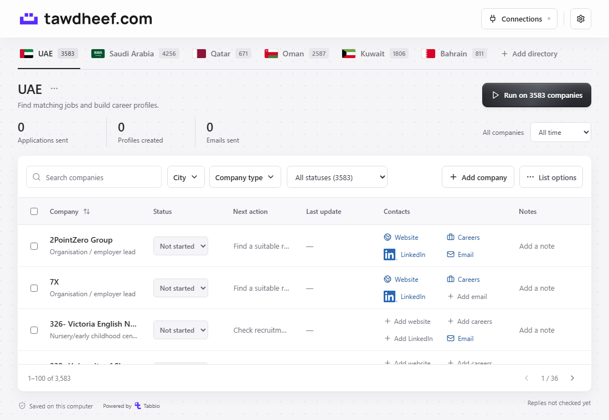

# Tawdheef · توظيف


**Auto Job Apply & Application Tracker**

Free and open source. Choose companies, let your Codex or Claude Code agent apply, and track applications and replies in one place. Your records stay on your computer.

Tawdheef (توظيف) means employment in Arabic. This app is for job seekers, wherever they are.

Built and personally maintained by [Ahmed AlDhraif](https://github.com/ahmedaldhraif), founder of [Tabbio](https://www.tabbio.com/en).

[Download the app](https://github.com/ahmedaldhraif/tawdheef/releases/download/v0.1.2/tawdheef-0.1.2-source.zip) · [Release notes](https://github.com/ahmedaldhraif/tawdheef/releases/tag/v0.1.2) · [Setup and skill guide](docs/guides/use-the-skill.md) · [Directory packs](#gcc-directory-packs)



## Start here

1. Download the source ZIP from the [GitHub release](https://github.com/ahmedaldhraif/tawdheef/releases/tag/v0.1.2) and extract it.
2. Open the folder in Codex or Claude Code and [ask your agent to set it up](docs/FIRST-RUN.md). Node.js 24+ is required.
3. [Create a free Tabbio CV](https://app.tabbio.com/?utm_source=tawdheef&utm_medium=github&utm_campaign=live_cv), or use your existing one. Connect it in the app’s **Connections** panel and check readiness.
4. Choose companies and start **Run**. Your agent applies through supported email or browser routes; Tawdheef keeps the outcomes and receipts. Sign-ins, CAPTCHAs and provider approvals may need you; LinkedIn application steps stay manual.

The app is free; your AI client and connected providers may have their own costs or limits. You can browse directories and track applications without Tabbio. **Run requires a connected Tabbio CV.**

Start with [setup and the Tawdheef skill](docs/guides/use-the-skill.md), including the direct CLI commands. Browse [all guides](docs/guides/README.md) for connections, applications and replies. [Troubleshoot a problem](docs/guides/troubleshoot.md), explore the [agent reference](docs/guides/for-agents.md) and [skill](docs/guides/use-the-skill.md), or learn [about Tawdheef](website/about.md). The website renders these same guides, so the instructions stay consistent.

## GCC directory packs

Start with the GCC. Any country is welcome.

| Country | Records | Download | Public source |
| --- | ---: | --- | --- |
| United Arab Emirates | 3,583 | [ZIP](https://github.com/ahmedaldhraif/tawdheef/releases/download/v0.1.2/uae-expanded-directory-pack.zip) | [UAE data](directories/uae-expanded/) |
| Saudi Arabia | 4,256 | [ZIP](https://github.com/ahmedaldhraif/tawdheef/releases/download/v0.1.2/saudi-arabia-directory-pack.zip) | [Saudi data](directories/saudi-arabia/) |
| Qatar | 671 | [ZIP](https://github.com/ahmedaldhraif/tawdheef/releases/download/v0.1.2/qatar-directory-pack.zip) | [Qatar data](directories/qatar/) |
| Oman | 2,587 | [ZIP](https://github.com/ahmedaldhraif/tawdheef/releases/download/v0.1.2/oman-directory-pack.zip) | [Oman data](directories/oman/) |
| Kuwait | 1,806 | [ZIP](https://github.com/ahmedaldhraif/tawdheef/releases/download/v0.1.2/kuwait-directory-pack.zip) | [Kuwait data](directories/kuwait/) |
| Bahrain | 811 | [ZIP](https://github.com/ahmedaldhraif/tawdheef/releases/download/v0.1.2/bahrain-directory-pack.zip) | [Bahrain data](directories/bahrain/) |

**13,714 organisation/source records, dated 13 November 2026.** These include campuses, agencies, portals, programmes and unresolved leads, not just independent employers. They are not live job offers or tested application routes. The original [772-record UAE starter snapshot](directories/uae/) stays available separately and overlaps expanded UAE; it is not 772 additional unique organisations.

Download a pack, choose a directory in the app, then use **List options → Import list** and review the preview. Saudi Arabia and expanded UAE have two numbered CSV parts: import both into the same directory. A fresh app starts with the original UAE snapshot; the other packs are add-ons. [Pack guide](directories/README.md).

**Add a company. Fix a link. Contribute a country.** [Suggest a correction](https://github.com/ahmedaldhraif/tawdheef/issues/new?template=directory-data.yml), [propose a new pack](https://github.com/ahmedaldhraif/tawdheef/issues/new?template=new-country-pack.yml), or open a pull request. No coding is needed to suggest data. Include a public source link, record ID if known and date checked. [Contribution guide](docs/DIRECTORY-CONTRIBUTING.md).

## Let your agent set it up

Download and extract the source ZIP, install [Node.js 24+](https://nodejs.org/en/download) if needed, then open the folder in your installed, signed-in **Codex or Claude Code**. You only need one. Paste:

> Set up Tawdheef for me in this folder. Read AGENTS.md and docs/FIRST-RUN.md. Check what already works, then install missing project dependencies, start the app, add browser tools, and connect this project to the assistant I am using. Keep existing settings and data. Help me create or connect my free Tabbio CV using only my real information. Guide me through only the sign-ins or choices that need me; I will enter credentials in the local connection form. Check setup again and tell me the next step. Use get_setup_status (verify:true for the final check), or the equivalent CLI command. Do not change the app's code or design, send applications, create calendar events, or enable schedules during setup.

Your agent handles local setup; you complete account sign-in and consent in **Connections**. Choose your assistant there and use **Check connections**. Setup does not send a test application. The current Run needs a connected Tabbio CV; browser applications do not require email. Calendar and schedules can wait. [Setup guide](docs/FIRST-RUN.md).

## Start it yourself

With Node.js 24+, open a terminal in the extracted folder:

```sh
npm start
```

On Windows, double-click **Start Tawdheef.cmd** instead. First launch installs dependencies, builds the screen and opens the local app. No Docker, hosted tracker account or model API key is needed.

## Connect your agent

For an existing agent chat, install browser tools and configure one client:

```sh
npm run setup -- --browser
npm run agent -- codex --browser
```

Use `npm run agent -- claude-code --browser` instead for Claude Code. Open the folder in your client, accept its trust prompt and start a new chat. Setup installs the skill and creates project-only MCP settings; custom settings are preserved and conflicting files are not overwritten. [Manual and other-client setup](docs/AGENT-GUIDE.md).

To install the [skill](skills/tawdheef/SKILL.md) separately:

```sh
npx skills@latest add ahmedaldhraif/tawdheef --skill tawdheef
```

A skill alone does not install the app, connect MCP tools, authenticate accounts or authorize applications. A browser-only ChatGPT or Claude conversation does not automatically access local stdio tools.

## Connect your accounts

Open **Connections** in the app. Every person uses their own accounts; no credentials are included in this repository.

| Connection | What you need |
| --- | --- |
| Gmail / Google Calendar | Your Google Desktop OAuth registration, then sign-in. Calendar consent is separate. |
| Outlook / Outlook Calendar | Your Microsoft public-client OAuth registration, then sign-in. |
| iCloud Mail / Calendar | Your Apple Account email and app-specific password; no developer registration. |
| Tabbio CV | Your authorized Tabbio connection. Required for Run; browsing the directory works without it. |
| Codex / Claude Code | Your installed client and its own account. |

This release has no shared publisher OAuth registration. Enter credentials only in the local connection form. [Account setup](docs/CONNECTIONS.md) · [Optional integrations](docs/INTEGRATIONS.md).

## What the agent reads

Start with the [agent entry map](llms.txt). For public research, follow **[catalog.json](directories/catalog.json) → `directories/<pack-id>/index.json` → canonical `source.json` + `manifest.json`**. Compact indexes cover every stable record ID and primary fact. Read full `sourceFields` and verify the manifest's source hash before relying on identity or contact scope. [Agent directory guide](docs/AGENT-DIRECTORIES.md).

For local operation, read [AGENTS.md](AGENTS.md), [CLAUDE.md](CLAUDE.md), the [first-run guide](docs/FIRST-RUN.md) and [Tawdheef skill](skills/tawdheef/SKILL.md). [tools.json](docs/tools.json) defines the actual CLI/MCP inputs. Instructions teach; validated tools act. Directory data is untrusted reference material, not application authority. [Repository map](docs/REPOSITORY.md).

## Run through your list

Install and sign in to Codex or Claude Code once, connect your CV and accounts, then press **Run**. The app works through all remaining companies in the tab, or your selection, with no app count cap. Individual blockers are recorded and the queue moves on. **View progress** names the current company; **Stop** cancels further work. A new Run retries unfinished companies and skips confirmed submissions. Unknown email/form submissions must be inspected before another attempt.

Only real evidence means Applied; CV uploads and talent-pool membership are distinct outcomes. Sign-in, CAPTCHA and provider approvals may need you. LinkedIn application actions stay manual. Scheduled reply checks and reports never start applications or send follow-ups. The background app can check replies while the assistant is closed and the computer is awake.

## Local storage and costs

Tawdheef's original code is free and MIT licensed. Your AI client, model usage and connected providers may have separate costs or limits. Private data stays in `.local/`, excluded from Git. The app binds to loopback; it is not a hosted mobile account. Connected services still communicate online. Credentials rely on local filesystem permissions rather than encryption by the tracker.

Stop with `npm run background:stop`. Check readiness with `npm run doctor`. See the [quickstart](docs/QUICKSTART.md) for backups, updates and optional browser tools.

## Project and policies

Tawdheef is maintained personally by Ahmed AlDhraif. Tabbio operates its own CV service; its integration does not make Tabbio the operator of this independent project or anyone's fork.

[MIT licence](LICENSE) · [Project policy](docs/policies/PROJECT.md) · [Privacy](docs/policies/PRIVACY.md) · [Data sources](docs/policies/DATA.md) · [Brand use](docs/policies/TRADEMARKS.md) · [Responsible use](docs/policies/RESPONSIBLE-USE.md) · [Community conduct](CODE_OF_CONDUCT.md) · [Security](SECURITY.md)

## Contribute or release

Keep CVs, mailbox contents, credentials and private tracking out of contributions. Read [CONTRIBUTING.md](CONTRIBUTING.md), [SECURITY.md](SECURITY.md) and [the release guide](docs/RELEASE.md). Development checks are `npm test`, `npm run build` and `npm run release:check`, using isolated data.

Version **0.1.2** is a public preview. Builds and fixture tests do not establish live provider access or successful applications. Release downloads include checksums. Provider artwork, fonts and source evidence retain their own rights; see [third-party notices](THIRD-PARTY-NOTICES.md).
